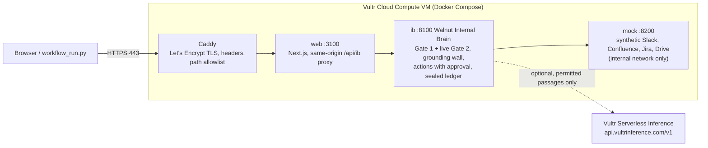
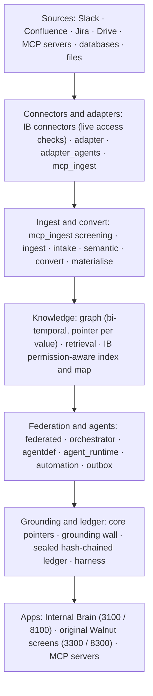

# Walnut DataBridge on Vultr

**Answers you can prove. Actions you approve.** An enterprise workflow agent for regulated companies,
deployed on one Vultr Cloud Compute VM, with Vultr Serverless Inference as an optional model.

> Entry for **Vultr Agent Rush** (lablab.ai), track **Powering the Future of Work**. All data is
> synthetic (a made-up fintech, "Company A"). Prior work is disclosed in [Prior work](#prior-work-disclosed).
>
> **Live demo:** `<DEMO_URL>` (sign-in: "I have a demo passcode", `<DEMO_PASSCODE>`) · **Video:** `<YOUTUBE_URL>`
> · **Status:** see [Deployment status](#deployment-status).

Staff at a regulated company lose hours stitching answers together from Confluence, Jira, Slack and
Drive, and an ordinary AI assistant can leak what they are not cleared to see, or act without anyone
approving it. Walnut runs the whole workflow instead: it answers **only from documents the asker may
open** (checked twice, the second time live at the source), **cites its sources**, drafts the
follow-up work, **creates nothing until a person approves**, and **seals every step** in a hash-chained
audit log that compliance can verify.

## Walnut on Vultr: the real task

**The workflow judges can run end to end: a procurement request** (finance / procurement).

| # | Step | Who | What happens | Proof in the ledger |
|---|---|---|---|---|
| 1 | **Ask** | Alex, IT admin | "Who approves spend of SGD 18,000 on 12 laptops, and how many written quotes does the purchase take?" | `request.accepted` (written before retrieval) |
| 2 | **Permission-checked retrieval** | Walnut | Gate 1 searches only what Alex may open; Gate 2 re-checks each passage **live** at the source and fails closed | `retrieval.decided` (before any model call) |
| 3 | **Cited answer** | Walnut (quoted, or a model on Vultr Serverless Inference) | Line manager, department head and Head of Finance above SGD 5,000; three written quotes and a PO above SGD 10,000, each with its own citation. The grounding wall drops any unsupported value or name | `answer.released` (before the response) |
| 4 | **Draft** | Walnut | The approval note to Alex's department head, built from cited sentences only. **Never sent** | `action.proposed` |
| 5 | **Propose** | Walnut | A follow-up ticket in the one Jira project Alex may create issues in (checked live). Nothing is created yet | `action.proposed` |
| 6 | **Approve, then execute once** | Alex (human) | Confirm re-checks access live, then creates `ITHELP-n` exactly once; declining cancels it | `action.confirmed` (write-ahead), then `action.executed`; or `action.rejected` |
| 7 | **Audit pull** | Maya, compliance | The request end to end: every document considered, each live Gate-2 verdict, every sealed record, **Verify audit chain** | `audit.query` |
| 8 | **Contrast** | Ken, external contractor | Same question, the constant refusal: no hint that a procurement policy exists | |

Run it against any running stack (standard-library Python; exit 0 only if every check passes):

```bash
python databridge/scripts/workflow_run.py --base https://<ip-with-dashes>.sslip.io --passcode <passcode>   # a deployment
python databridge/scripts/workflow_run.py --ib http://127.0.0.1:8100 --approve                            # a local Brain
sudo bash /opt/walnut/repo/deploy/docker/deploy.sh workflow                                               # on the Vultr VM
```

Without `--approve` it stops at step 6 and asks on the terminal. `--scenario support` runs the second
workflow: Amy, an account manager, gets the approved customer script for a restricted business account,
a reply draft that uses that script word for word, and a ticket request that is **refused at action
time** because she may not create issues anywhere. In the web app the same flow is **Ask -> Act on this
answer -> Confirm**: sign in as Alex (IT admin), click the laptop question, then **Create follow-up ticket**. Then
sign in as Maya for **Developer -> Journey / Audit**.

### Vultr services used

| Vultr service | Role | Where |
|---|---|---|
| **Cloud Compute VM** (Ubuntu 24.04, 2 vCPU / 4 GB, Singapore) | The backend (Walnut Internal Brain and the synthetic mock platforms) **and** the web app, in Docker Compose | [`deploy/docker/`](deploy/docker/README.md), [`deploy/vultr/`](deploy/vultr/README.md) |
| **Firewall group** | Only TCP 22 (operator IP), 80 and 443 reach the VM | [`deploy/vultr/README.md`](deploy/vultr/README.md) §2, `provision.py` |
| **Cloud-Init user-data** | First boot installs Docker, clones the repo, generates secrets on the VM, starts the stack, runs the smoke test | [`deploy/vultr/cloud-init.yaml`](deploy/vultr/cloud-init.yaml) |
| **Serverless Inference** (optional, OpenAI-compatible) | The model that writes answers and drafts from permitted passages only; set by environment (`IB_MODEL_URL=https://api.vultrinference.com/v1`, `IB_MODEL_NAME`, `IB_MODEL_KEY`), with fallbacks and spend caps | `deploy.sh configure-model vultr`, [`deploy/vultr/check_inference.py`](deploy/vultr/check_inference.py) |
| **Vultr API v2** (optional) | One command creates the firewall group, SSH key and VM | [`deploy/vultr/provision.py`](deploy/vultr/provision.py) (dry run by default) |

#### Deployment status

**Not yet run on a live Vultr account**; the public URL is a placeholder until it is. What has been run: the first-boot
`cloud-init.yaml` with real cloud-init on a clean Ubuntu 24.04 userland (a systemd container, not a Vultr VM), which
installed Docker, built the images and reached the smoke test in 14 to 19 minutes on a busy laptop, using Caddy's local CA rather than Let's
Encrypt ([docs/VULTR_RUN.md](docs/VULTR_RUN.md)). Not run: the Vultr API calls, the firewall group, a real
certificate, and any Serverless Inference call; their request shapes were checked against Vultr's published client
and docs. No model key is in this repository.

### Architecture on one Vultr VM



Only Caddy publishes ports. `mock` has no route to the internet; `web` calls only `ib`; `ib` calls out only to the
configured model endpoint. Containers run read-only, non-root, with every capability dropped. How to
deploy: [`deploy/vultr/README.md`](deploy/vultr/README.md).

### Proof

| Check | Result | Command (from `databridge/`) |
|---|---|---|
| The real-task workflow in process, over the real mock platforms and connectors (approve, decline, no terminal, support refusal, repeat runs) | 9 tests pass | `PY -m pytest apps/internal_brain/tests/test_workflow_run.py -q` |
| The adapter and the inference checker against a local server answering in the shapes Vultr documents (reasoning, catalogue, errors; env only), the Vultr API plan, static checks on the kit | 24 tests pass | `PY -m pytest apps/internal_brain/tests/test_vultr_kit.py -q` |
| Citation chips on quoted answers, the Alex persona | 9 tests pass | `npx playwright test -c tests/e2e/pure.config.ts` in `apps/internal_brain_web` |
| First boot on a clean Ubuntu 24.04 userland: real cloud-init, Docker installed from scratch, images built, smoke through the edge | Smoke 33 of 33 (four more checks run on a real host) | [`docs/VULTR_RUN.md`](docs/VULTR_RUN.md) |
| The workflow through the Docker stack's public edge (Caddy -> web -> Brain) | 7 of 7 steps pass | [`docs/VULTR_RUN.md`](docs/VULTR_RUN.md) |
| Synthetic leak evaluation (30 Oct 2026, pre-existing): 0 leaks in 7,374 adversarial requests; 0 of 400 restricted-vs-nonexistent pairs distinguishable; 0 hard failures in 1,152 injection attempts | run with a capturing test model and the quoted path, **not** a Vultr model | [§6](#6-evaluation) |

### Prior work, disclosed

Walnut DataBridge (the permission gates, grounding wall, audit ledger, act-with-approval, the web app and
the synthetic Company A world) was built from August 2026, before this hackathon. **New for Agent Rush:**
the Vultr deploy kit (`deploy/vultr/`: cloud-init, Vultr API provisioning, inference checker); the
`configure-model vultr`, `models`, `check-model` and `workflow` operations and failure handling in
`deploy/docker/deploy.sh`; the compose and env changes for Vultr Serverless Inference, including the
`IB_MODEL_REASONING_EFFORT` setting in the model adapter; the real-task workflow runner
(`databridge/scripts/workflow_run.py`); in the web app, the procurement starter question, the Alex persona's label and
landing page, and a fix to how citation chips attach to quoted answers; their tests; and this documentation. File by file: [docs/AGENT_RUSH_CHANGES.md](docs/AGENT_RUSH_CHANGES.md).

### Licence

The code is Apache-2.0 ([LICENSE](LICENSE)). The hackathon asks for MIT-compliant open source; a proposed
MIT licence is in [LICENSE.MIT.proposed](LICENSE.MIT.proposed) and needs the copyright holders' sign-off
before it replaces `LICENSE`.

---

## About Walnut DataBridge

Walnut DataBridge gives staff at a regulated company one place to ask a question across Confluence,
Jira, Slack and Google Drive. **Internal Brain**, the ask product inside it, answers only from what the
asker may open, checks each source live, and writes every step to a tamper-evident audit log.

It runs with **no AI model at all**: by default every answer is quoted straight from the permitted
sources. An AI model is optional and plugs in through one provider-neutral adapter
([§2](#2-optional-plug-in-an-ai-model)).

| Read next | What it holds |
|---|---|
| [INTERNAL_BRAIN.md](INTERNAL_BRAIN.md) | The guide to Internal Brain: walk-through, how it works, proof, limits |
| [docs/FEATURE_CATALOGUE.md](docs/FEATURE_CATALOGUE.md) | Every feature: who can use it, where it is, the test behind it |
| [docs/PLATFORM.md](docs/PLATFORM.md) | The Walnut platform underneath: every package and its tests |
| [docs/ARCHITECTURE.md](docs/ARCHITECTURE.md), [docs/SECURITY.md](docs/SECURITY.md) | How Internal Brain is built; the threat model, controls and review dispositions |
| [docs/responsible_ai/](docs/responsible_ai/README.md) | Responsible-AI evidence pack: system card, OWASP LLM red team, framework crosswalk |
| [docs/README.md](docs/README.md) | Index of all docs (architecture, security, data flows, contracts, decisions, changelog, test report) |
| [STATUS.md](STATUS.md) | Where the build is |

**Data.** Synthetic only: a made-up fintech, "Company A" (34 people; 231 Confluence pages, 261 Jira
issues, 628 Slack threads, 87 Drive files). The four platforms are mock servers that use the real APIs'
shapes, permission models and webhooks. The connectors have not been run against a live tenant.

## 1. Run it

**You need:** Python 3.13 and Node 20; on Windows, Git for Windows (the launcher is a bash script).
Ports 3100, 8100, 8200, 8300 and 3300 must be free.

**One-time setup** (from `databridge/`):

```bash
# macOS / Linux
python3.13 -m venv .venv && .venv/bin/python -m pip install -r requirements-lock.txt
(cd apps/internal_brain_web && npm install)
cp .env.ib.local.example .env.ib.local      # local keys; git-ignored. Fill in the values it asks for
```

```powershell
# Windows (PowerShell)
py -3.13 -m venv .venv; .venv\Scripts\python -m pip install -r requirements-lock.txt
cd apps\internal_brain_web; npm install; cd ..\..
Copy-Item .env.ib.local.example .env.ib.local
```

**Start everything** (from the repo root; Git Bash on Windows):

```bash
bash databridge/scripts/demo_up.sh start --fresh
```

[`demo_up.sh`](databridge/scripts/demo_up.sh) starts, in order:

| # | What | Port |
|---|---|---|
| 1 | Mock Slack, Confluence, Jira and Drive | 8200 |
| 2 | Internal Brain service (indexes the whole world on start) | 8100 |
| 3 | `--fresh` only: wipes `databridge/var/ib-final` and seeds about 300 labelled replay questions through the real pipeline (about 2 minutes) | |
| 4 | Walnut engine gateway and the original Walnut screens | 8300, 3300 |
| 5 | Web app: a production build, then `next start` | 3100 |

Open http://127.0.0.1:3100 (User mode; the switch at the top left goes to Developer mode,
http://127.0.0.1:3100/dev). Sign in by picking a person. There is no password; the demo sign-in stands
in for single sign-on. `demo_up.sh status` lists the ports, `demo_up.sh stop` stops everything, and logs
are in `databridge/var/ib-final/logs/`. Everything binds to 127.0.0.1.

**By hand, without bash** (PowerShell, from `databridge/`, one shell each):

```powershell
$env:PYTHONPATH="apps/mock_platforms"; .venv\Scripts\python -m mock_platforms --port 8200
$env:PYTHONPATH="apps/internal_brain;packages/core;packages/harness;packages/adapter;packages/retrieval"; $env:IB_DEMO_LOGIN="1"; .venv\Scripts\python -m databridge_ib
cd apps\internal_brain_web; npm run dev
```

This path starts no demo history and no engine gateway. To look at the screens with no backend at all:
`npm run dev:mock` in `databridge/apps/internal_brain_web` (built-in mock data, clearly labelled).

**Tests** (from `databridge/`; `PY` is `.venv\Scripts\python` on Windows, `.venv/bin/python` elsewhere):

| What | Command |
|---|---|
| Internal Brain tests | `PY -m pytest apps/internal_brain/tests -q` (with the `PYTHONPATH` above) |
| Platform suites | `PY -m pytest <dir> -m "not integration" -q`, one directory at a time |
| Leak evaluation | `PY -m evals.internal_brain.run` (add `--limit 60` for a one-minute check) |
| Tamper demo | `PY scripts/tamper_demo.py` |
| Web end-to-end | `npm run e2e` in `apps/internal_brain_web` (mock mode, port 3101; run `npx playwright install chromium` once) |

## 2. Optional: plug in an AI model

The default is deterministic: the Brain composes the answer by quoting the permitted passages, with the
same permission checks and the same grounding check. No model, no network call, no key.

To have a model write the answer, set these in the environment or in `databridge/.env.ib.local`:

| Variable | Meaning |
|---|---|
| `IB_MODEL_URL` | Base URL of any chat-completions-style JSON endpoint (hosted or local) |
| `IB_MODEL_NAME` | The model name to request |
| `IB_MODEL_KEY` | Optional bearer key, if the endpoint needs one |
| `IB_MODEL_FALLBACKS` | Optional comma-separated model names, tried in order if the first fails |

The adapter is a plain HTTPS client. There is no vendor SDK and no built-in default URL or model, so
nothing is called until you set `IB_MODEL_URL` and `IB_MODEL_NAME`. `IB_FORCE_OFFLINE=1` forces the
deterministic path even when a model is configured.

Whatever model you use:
- it sees only passages that passed both permission gates;
- the grounding check still runs on its answer, and a failed answer is replaced by the quoted one;
- if every model fails, you get the quoted answer;
- every answer says which path served it ("AI model" or "quoted from sources").

## 3. Three workflows

| # | Workflow | Who | What it shows |
|---|---|---|---|
| 1 | **Onboarding**: "Your first day leading Project Atlas" | A new project lead | A briefing on a named project, scoped to that project's own documents, through both permission gates (`fixtures/scenarios/atlas_onboarding/`, `databridge_ib/subject.py`; run with `IB_WORLD=atlas bash databridge/scripts/demo_up.sh start`) |
| 2 | **The account-restriction call**: Amy vs Rachel | Amy (account manager) and Rachel (money-laundering reporting officer) ask the same question about Velquarry Trading | Each gets only what they may open. Amy gets the approved customer script and the constant refusal, never a hint that a case exists |
| 3 | **The audit and tamper check** | Maya (compliance) | The request end to end (journey, Gate-2 verdicts), **Verify audit chain**, and the tamper demo on a copy: any edit, deletion or restore breaks the chain |

The step-by-step walk-through is in [INTERNAL_BRAIN.md](INTERNAL_BRAIN.md#walk-through).

## 4. Architecture



One request through Internal Brain:

1. **Who is asking.** A signed token, from the web app or an MCP client. No request body, tool argument
   or model output can name a person.
2. **Gate 1.** Search only documents this person may open, using each platform's own permission model.
   Ranking statistics come from those documents only.
3. **Gate 2.** Ask the platform again, live, for every passage about to be used. An error, timeout or rate
   limit means deny.
4. **Answer.** The quoted answer, or the optional AI model over the permitted passages only. The
   grounding wall drops any value or name not in the evidence; on violation, the quoted answer is served.
5. **Record.** The audit log is written ahead: before retrieval, before any model call, and before the
   answer is shown. If it cannot be written, nothing is answered (503).

The security properties, each with its test, are listed in [INTERNAL_BRAIN.md](INTERNAL_BRAIN.md#how-it-works):
the two permission gates, identity only from the signed token, the write-ahead audit, "restricted" is
indistinguishable from "does not exist", the grounding wall and the deterministic quoted answer.

| Capability | What it does | Code |
|---|---|---|
| **Source connectors** (Slack, Confluence, Jira, Drive) | Read each platform through its real API shape and re-check the asker's access live, per document | [`databridge_ib/connectors/`](databridge/apps/internal_brain/databridge_ib/connectors) |
| **Adapter contract and policy** | One frozen request type per read, a policy engine per source, no I/O in the contract | [`packages/adapter`](databridge/packages/adapter) |
| **Adapter agents and the adapter builder** | Describe a source in plain English; the builder compiles it and an adapter agent keeps its MCP connections synced, screened and fresh | [`packages/adapter_agents`](databridge/packages/adapter_agents) |
| **MCP ingest** | Connect any MCP server: approved crawl plan, raw bytes captured, deterministic screening before any model | [`packages/mcp_ingest`](databridge/packages/mcp_ingest) |
| **Knowledge and evidence graph** | A typed, bi-temporal graph; every node and link cites its source row | [`packages/graph`](databridge/packages/graph) |
| **Federated engine** | One read-only agent per source; results combined with exact decimal arithmetic | [`packages/federated`](databridge/packages/federated) |
| **Orchestrator and agent runtime** | An agent runs only under compiled grants; every write is a proposal a named human approves | [`orchestrator`](databridge/packages/orchestrator), [`agentdef`](databridge/packages/agentdef), [`agent_runtime`](databridge/packages/agent_runtime) |
| **Grounding wall and source pointers** | Checks each model sentence against the permitted passages: every number, date or ID must match one, and a sentence with nothing behind it is dropped. It does not check which passage a sentence cites | [`core/provenance.py`](databridge/packages/core/databridge_core/provenance.py) |
| **Sealed, hash-chained ledger** | Every request written ahead, sealed and chained | [`core/decision_ledger.py`](databridge/packages/core/databridge_core/decision_ledger.py), [`databridge_ib/audit/`](databridge/apps/internal_brain/databridge_ib/audit) |
| **Model harness** | The only code allowed to call a model; provider-neutral | [`packages/harness`](databridge/packages/harness) |

Test counts per package are in [docs/PLATFORM.md](docs/PLATFORM.md).

## 5. MCP: ask from any MCP client

Internal Brain is also an MCP server, so any MCP client can ask it questions under the same two gates.
Every call is written to the ledger with channel `mcp`.

- `python -m databridge_ib.mcp_server`: the employee server (ask, sources, own receipts). Identity comes
  only from the `IB_TOKEN` bearer token; no tool takes a user argument.
- `databridge_ib.audit_mcp_server`: the compliance audit server.
- [`scripts/mcp_client_setup.py`](databridge/scripts/mcp_client_setup.py) `--out DIR` writes one standard
  `mcp.json` (`{"mcpServers": {...}}`) per persona, each with a short-lived token minted by
  [`scripts/ib_mint_token.py`](databridge/scripts/ib_mint_token.py). `DIR` must be outside the repository
  (tokens are secrets). `--client-config FILE` merges the two employee connectors (`ib-as-jdoe`,
  `ib-as-ken`) into a client's own list; the compliance connector (`ib-compliance`) never goes into the
  same list (`--compliance-client-config FILE` on a separate seat).

## 6. Evaluation

From [RESULTS.md](databridge/evals/internal_brain/RESULTS.md) and its summary
[eval_summary.json](databridge/apps/internal_brain_web/public/eval_summary.json). The runs use a
capturing test model and the quoted-answer path.

| What | Result |
|---|---|
| Restricted content in any prompt, answer or response | **0 leaks in 7,374** adversarial requests (3,687 probes × 2 answer paths; 95% upper bound 0.08% per request on each path) |
| "Restricted" vs "does not exist" | **0 of 400** paired questions differ |
| Prompt injection planted on all four platforms | **0 hard failures in 1,152** injection-relevant requests |
| Allowed sources reaching the answer step | **100%** on both paths; the answer cites the expected source in 93.2% (quoted) to 97.1% (model) |
| Eval canaries | A leaky configuration is caught; deny-everything scores 0% usefulness |

## 7. Deploy

[`deploy/docker/`](deploy/docker/README.md) is a hardened docker-compose stack for any Docker host:
Caddy with automatic HTTPS as the only public listener, internal-only backend network, read-only
containers with all capabilities dropped, and a passcode-gated sign-in. On Vultr (one Cloud Compute VM,
firewall group, cloud-init, optional Serverless Inference): [`deploy/vultr/`](deploy/vultr/README.md).

## 8. Repository map

| Path | What is in it |
|---|---|
| `databridge/apps/internal_brain/` | The Internal Brain service (`databridge_ib`), port 8100 |
| `databridge/apps/internal_brain_web/` | The Walnut DataBridge web app (Next.js), port 3100 |
| `databridge/apps/mock_platforms/` | Mock Slack, Confluence, Jira and Drive, port 8200 |
| `databridge/evals/internal_brain/` | The leak and injection evaluation |
| `databridge/packages/`, `databridge/packs/` | The Walnut engine and its domain packs |
| [`docs/`](docs/README.md) | Architecture, security, data flows, responsible AI, feature catalogue, platform inventory, contracts, decisions, changelog, test report, screenshots |
| [`deploy/docker/`](deploy/docker/README.md) | The Docker deployment |
| [`AGENTS.md`](AGENTS.md) | Rules for anyone (person or coding agent) changing this repo |

## Why this exists

The data a company needs already exists. Getting to it is the problem.

| | |
|---|---|
| **"The biggest obstacle to using advanced data analysis isn't skill base or technology; it's plain old access to the data."** | Harvard Business Review |
| **25%** of a team's time goes to searching for answers | Atlassian, *State of Teams 2025* (12,000 knowledge workers) |
| **5.3 hours** a week, per person, spent waiting on colleagues for information or recreating work that already exists | Panopto with YouGov, 2018 (1,001 employees) |
| **60%** of AI projects unsupported by AI-ready data will be abandoned through 2026 | Gartner, Feb 2025 |

In a fintech the problem has a second edge. An assistant that can read everything can leak everything,
and telling the wrong person that a suspicious-transaction report exists is a criminal offence. So the
answer has to be **useful and permission-safe at the same time**. That is what the Internal Brain does.

---

# The Walnut engine

Walnut is an evidence layer for AI systems. Every value it emits carries a proof of where it came from,
and anyone can re-run that proof. A value with no proof is refused when it is created. It is not logged
as a warning or flagged for later review.

Most provenance in AI infrastructure today is lineage. It works at dataset level, is computed after the
fact, and is trusted because the vendor says so. Walnut's claim is narrower and checkable: provenance is
a property of each individual value, and an outsider can verify it by re-running the pointer.

The repository began as one product, a healthcare intake flow, and was then generalised. The engine now
knows no domain. Healthcare, finance and government are **packs**, declared in YAML, on top of the same
core. Where a claim is shown in one pack rather than built into the engine, the text says so.

## How it works

Each point below is a type or a test in this repository, and names the file that enforces it.

**Every value is a `GroundedValue` with a `SourcePointer`, or it does not exist.**
`packages/core/databridge_core/provenance.py` defines the pointer as a sealed Pydantic model
(`frozen=True`, `extra="forbid"`, `revalidate_instances="always"`). It has ten closed kinds, such as
`table_cell`, `doc_span`, `email_part`, `ocr_bbox` and `generated_claim`. Each kind has its own required
locator fields, checked when the object is built. A pointer with a missing field, or an extra field the
type does not declare, fails at the call site. It does not fail three layers later.

**A cell is one of four states, never a bare value.**
`Cell = Union[GroundedValue, Transformed, Withheld, Absent]`. Two states disclose a value and carry proof
of the source. Two are non-answers and carry proof of what produced the non-answer: a policy decision
(`Withheld.record`, naming the policy, the principal, the purpose and the decision event) or a snapshot
(`Absent.snapshot`, naming the source and the moment asked). A `Withheld` cell cannot carry a
`SourcePointer`, because that would vouch for something the reader never saw. `assert_withheld_disjoint`
checks that no field is both disclosed and withheld, and that a withheld field never leaks into an
`unresolved` list.

**Trust is a label on where a value came from, not a confidence score.**
`SourcePointer.trust` is `TRUSTED` or `UNTRUSTED`. The adapter that reads the source sets it from that
source's own contract. An operator-controlled config table is `TRUSTED`. An email body, a chat message,
an OCR'd page or anything a model wrote is `UNTRUSTED`, however accurate it is. Trust combines by
least-upper-bound (`trust_from_parents`): a value derived from ten trusted facts and one untrusted fact
is untrusted. A `generated_claim` (model output) is untrusted by construction and cannot be turned into
`TRUSTED` by wrapping it in an aggregation. `effective_trust` re-derives the label from ancestry at read
time, so a label written by code that skipped validation does not survive use.

**Verification returns one of eight states, never a boolean.**
In `packages/adapter/databridge_adapter/verdicts.py`: `VERIFIED`, `VERIFIED_AS_OF_CAPTURE`,
`DRIFT_BENIGN`, `DRIFT_MATERIAL`, `EXPIRED`, `VANISHED`, `FORBIDDEN`, `UNVERIFIABLE`. Each source falls
into a pinning tier: T0 native snapshot, T1 monotonic cursor, T2 current-addressable, T3 unversioned.
`DRIFT_BENIGN` is a capability an adapter must advertise before it can claim it.
`assert_verdict_advertised` refuses a source that reports a verdict it has no signal to compute.

**The graph closes facts; it never deletes them.**
State is bi-temporal. Every fact records when it was true in the world and when the system learned it.
A correction is a new row, and the old row is closed out, not overwritten. `GraphStore` exposes only
`current()` and `as_of()`, so no temporal predicate appears in application code.

**Identity resolution proposes candidates. A named human confirms.**
No pack's resolver can return a result that treats identity as settled. In
`packages/graph/databridge_graph/merge.py`, `requires_human_selection` is computed from each enabled
pack's declared `subject_kinds`, not from a hardcoded entity name. The healthcare pack's patient resolver
(`packages/intake/databridge_intake/resolve.py`) shows it: candidates are ranked and flagged, never
merged, and a name-only match with no matching identifier comes back with a note instead of being trusted.

**An adapter is five verbs, and natural language never crosses the boundary.**
`packages/adapter/databridge_adapter/port.py` defines `describe`, `snapshot`, `plan`, `resolve` and
`verify` as a runtime-checked `Protocol`. `assert_conforms` checks the full signature of every verb, not
only the name, because a name-only check lets an unusable adapter register. A model may propose a
request (`CapabilityRequest`) that a deterministic validator then accepts or rejects. A model may never
assign trust, decide a policy outcome or pick an identity candidate.

## Engine architecture

Four planes, each with one job and one failure mode. An evidence plane cuts through all of them.

```
BUSINESS PLANE       objects · actions · measures — actions are the only write path
MATERIALISATION      Materialisation Plan → Receipt (the plan hash is the dataset's identity)
STATE PLANE          bi-temporal graph — join / time-travel / per-attribute citation
CONNECTION PLANE     adapter fleet — one adapter per source, Core/Policy deterministic, Shell thin
                      ────────────────────────────────────────────────────
EVIDENCE PLANE       GroundedValue · SourcePointer(+trust) · verdict lattice · ledger
                      (cuts vertically through all four)
```

Each adapter has three parts:

- **Core** owns the driver, auth, pagination and provenance emission. It never runs a model.
- **Policy** runs the capability, grant, purpose and budget checks in-process. It never runs a model and
  never makes a per-cell network call.
- **Shell** turns an orchestrator's task into a validated request or an escalation. It holds no
  credentials and no driver handle. It is the only place a model runs inside the adapter fleet.

## Domain packs

`packs/healthcare/`, `packs/finance/` and `packs/government/` each declare their own node and edge
vocabulary, subject kinds and business rules in YAML. The engine (`packages/core`, `graph`, `harness`,
`convert`, `adapter`) refers to none of them. `test_no_domain_branching`
(`packages/graph/tests/test_no_domain_branching.py`) fails the build on any `if pack == "..."` in engine
code. A fourth pack is a YAML change plus fixtures, not a code change.

## What is built

This list is checked against the code. [`STATUS.md`](STATUS.md) is the current version.

**Working:**
- The provenance primitives (`packages/core`) and the four-cell-state model, with property tests for
  every pointer kind and every laundering path the reviews found.
- Four adapters: Postgres (T0/T1); a mailbox adapter over raw `.eml` files (T1/T3, everything it returns
  is `untrusted`); a document and OCR adapter (T3, no past to return to); and one adapter that wraps a
  pinned, sandboxed MCP server (everything `untrusted`, digest-pinned, quarantined if its description
  changes). A content-addressed, write-once capture store sits behind them, and `email_part` and
  `ocr_bbox` pointers resolve against it instead of the live source.
- A bi-temporal graph loaded from realistic synthetic estates: one finance, one government, each with tens
  of thousands of rows or nodes. Injection payloads are planted in both and contained. They can be cited
  and quoted, and they never reach a control-flow sink.
- A gateway (`/evidence`, `/trace`, `/ontology`, `/builder`, `/materialise`, plus the healthcare pack's
  `/intake` surface) and a frontend with a pointer inspector, an adapter communication graph and an
  ontology library.
- A data agent and plan compiler that produce a tabular dataset (Receipt, Parquet and Croissant 1.1) from
  a request over the finance graph. The compiler refuses plans on the wrong temporal axis or with a
  missing pointer for any cell.

**Not built:**
- **Incremental join.** The claim that a ninth source can join an eight-source graph with no rebuild has
  no test yet. It is the largest untested architectural bet in the repository.
- **Actions as the only write path.** The rule is declared but not enforced. No invocation path runs an
  action yet, and there is no `automation.mode` gate. Writes today go through pack-specific code. The
  healthcare pack's append-only ledger (`packages/intake/databridge_intake/ledger.py`) does enforce
  insert-only with database triggers and a staff-attestation gate, but that is one pack showing the
  pattern, not the engine enforcing it.
- **Postgres 19 with SQL/PGQ**, the intended production graph store. Everything runs on SQLite today.
- **Conformal risk certificates.** The `unresolved` list exists but has no error bound attached.

## Run the original Walnut platform

For Internal Brain, use [§1 Run it](#1-run-it). This section starts the original Walnut gateway and
frontend on ports 8000 and 3000.

```powershell
cd databridge
.\start-databridge.ps1        # frees ports 8000/3000, starts the gateway and the frontend
```

| URL | What it is |
|---|---|
| `http://127.0.0.1:8000/health` | Gateway health, and which model backend is in use |
| `http://localhost:3000` | The frontend: pack screens plus the platform screens |

```powershell
cd databridge
.venv\Scripts\python -m pytest -m "not integration"
```

Keep the marker: integration tests expect live services.

No API key is needed. Without a model configured, a deterministic backend runs the same code paths
offline, and no test in the suite needs a live model. Model access goes through `packages/harness` only;
nothing else in the repository imports a model client. Routing is a config file,
[`databridge/config/models.yaml`](databridge/config/models.yaml), so pointing the system at a hosted
endpoint or at a local model with no network is a config change.

## Engine layout

```
databridge/
  packages/
    core/          GroundedValue / SourcePointer: the provenance primitives
    harness/       model-agnostic model layer; call sites name a task class, never a model
    convert/       document IR + the grounding wall (drops any extraction not verbatim in its source)
    graph/         the bi-temporal knowledge graph, pack loading, identity merge rules
    adapter/       the five-verb port, the three-part adapter fleet, the capture store
    agentdef/      agent declaration → compiled capability grant set
    materialise/   materialisation plan compiler, receipts, Croissant output
    agent/         a read-only agent loop over sealed adapters (screen → plan → read → compose → screen)
    intake/        the healthcare pack's product logic: classify → extract → ground → resolve →
                   eligibility → prefill → billing → ledger
    outbox, evals, ingest, semantic   supporting packages
  apps/
    gateway/       FastAPI backend: platform routes plus each pack's own routes   (:8000)
    frontend/      Next.js: platform screens plus each pack's own screens         (:3000)
    mcp_server/    the graph exposed to agents over MCP
    cli/           headless commands
  packs/
    healthcare/, finance/, government/    domain vocabulary and rules, YAML, no engine code
  fixtures/        synthetic estates and documents behind the packs (no real data)
```

## Data

Every dataset in this repository (patients, insurers, account holders, case files, correspondence) is
synthetic. No real personal data is used to build, test or demonstrate this system.
